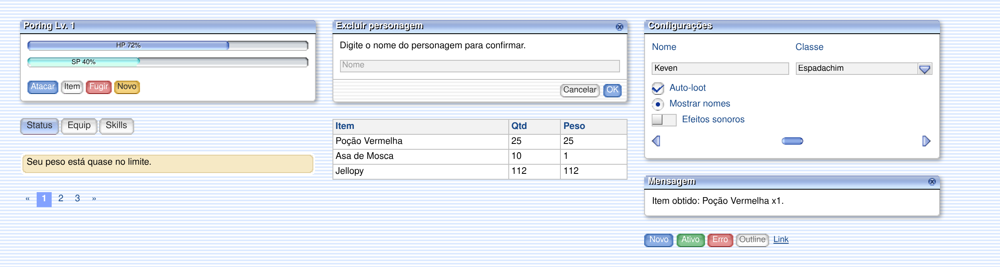

<div align="center">

# C-RO

**Kit CSS/JS no estilo da interface do Classic Ragnarok Online (2002), sobre o Bootstrap 5.3.8.**

Escreva o Bootstrap de sempre. A página sai com as janelas, botões, formulários, abas, barras, cursores e favicon do jogo.

[](https://kevencastilho.github.io/C-RO_WebKit/)
[](https://getbootstrap.com/)
[](LICENSE)

[**Documentação**](https://kevencastilho.github.io/C-RO_WebKit/) ·
[**Exemplos ao vivo**](https://kevencastilho.github.io/C-RO_WebKit/docs/exemplos/index.html) ·
[**Começar em 1 minuto**](#começar-em-1-minuto) ·
[**Baixar**](https://github.com/KevenCastilho/C-RO_WebKit/archive/refs/heads/main.zip)

<sub>Vai pedir a uma IA para conhecer ou usar o C-RO? Aponte para a <a href="https://kevencastilho.github.io/C-RO_WebKit/docs/ai/index.html">documentação para IAs</a> (https://kevencastilho.github.io/C-RO_WebKit/docs/ai/index.html).</sub>



</div>

## O que é

Um tema completo para o Bootstrap 5 que reproduz a interface clássica do Ragnarok Online. Você não aprende classes novas: `btn`, `card`, `modal`, `form-control`, `nav-tabs`, `progress` e o resto continuam sendo escritos do jeito normal, e o resultado sai com a cara do jogo.

Os sprites (janela, barra de título, botões, ícones, barras) foram medidos nos bitmaps do jogo e reproduzidos em CSS pixel a pixel. Não há imagens externas: **um CSS e um JS** resolvem tudo, sem Node e sem build.

## Destaques

- **Bootstrap padrão.** Marcação 100% Bootstrap 5.3.8: botões, formulários, abas, card, modal, offcanvas, toast, popover, tooltip, tabela, paginação, progress, alert, badge e os demais componentes.
- **Janelas fiéis ao jogo.** Barra de título em degradê, corpo branco, rodapé listrado, cantos recortados pixel a pixel e sombra que segue a silhueta.
- **Cursores do Ragnarok.** Os cursores do jogo, inclusive os animados, aplicados sozinhos conforme o elemento (seta, mão, barra I, espera, bloqueado e outros).
- **Favicon automático.** Se a página não declara um favicon, o do kit é aplicado.
- **Peças nativas do jogo.** Além do Bootstrap: classes `cro-*` para janela, barra de título, slots de inventário, barras HP/SP, grupos, árvore, menu, ícones do jogo, diálogos (`CRO.alert`, `CRO.confirm`, `CRO.prompt`) e menu de contexto.
- **Personalizável.** Cores, fontes e medidas vêm de variáveis CSS `--cro-*`; o seu CSS sempre vence o do kit.
- **Documentação em português** com 100+ páginas e mais de 200 exemplos que rodam ao vivo.
- **Honesto sobre a fidelidade.** Cada item da docs é marcado como **CONFIRMADO**, **DERIVADO** ou **INVENTADO** (veja [Fidelidade](#fidelidade-ao-jogo)).

## Começar em 1 minuto

### 1. Baixe e copie (recomendado)

Em **Code → Download ZIP**, copie de `dist/` o CSS, o JS e a pasta `fonts/` (ela precisa ficar ao lado do CSS):

```html
<!DOCTYPE html>
<html lang="pt-BR">
<head>
  <meta charset="utf-8">
  <meta name="viewport" content="width=device-width, initial-scale=1">
  <title>Meu site</title>
  <link rel="stylesheet" href="c-ro-bs.min.css">
</head>
<body>
  <button class="btn btn-primary">Olá, aventureiro!</button>
  <script src="c-ro-bs.min.js"></script>
</body>
</html>
```

### 2. Ou aponte para o GitHub Pages

Funciona sem copiar nada, mas serve sempre a versão atual da `main` (o repositório não usa tags). Para produção, prefira copiar os arquivos.

```html
<link rel="stylesheet" href="https://kevencastilho.github.io/C-RO_WebKit/dist/c-ro-bs.min.css">
<script src="https://kevencastilho.github.io/C-RO_WebKit/dist/c-ro-bs.min.js"></script>
```

> Não use `raw.githubusercontent.com`: o GitHub serve esses arquivos como texto puro e o navegador recusa o CSS e o JS.

## Qual arquivo usar

| Arquivo | Quando usar |
|---|---|
| `dist/c-ro-bs.min.css` + `dist/c-ro-bs.min.js` | **O caso comum.** Kit + Bootstrap 5.3.8 em um CSS e um JS |
| `dist/c-ro.min.css` + `dist/c-ro.min.js` | Só o kit, sem o Bootstrap (classes `cro-*`) |
| `dist/c-ro-bs.css`, `dist/c-ro.css` e `.js` | As mesmas versões, legíveis, para estudar e depurar |
| `dist/c-ro.lite.min.css` | Kit sem as peças específicas do jogo (botão Fechar, mesbtn com ícone, barra de diálogo/tooltip, sysbox), menor. Usa o `c-ro.min.js` |
| `dist/fonts/` | Fonte do kit. Precisa ficar ao lado do CSS |
| `dist/favicon/` | Ícones do kit, se quiser servi-los como arquivo |

Não misture o `c-ro.css` com o Bootstrap original: o `c-ro-bs.css` já inclui o Bootstrap, e dois Bootstraps na mesma página causam conflitos.

## Personalizar

Mude o visual sem editar o kit, redefinindo variáveis em `:root` ou em qualquer container:

```css
:root { --cro-accent: #a01a8c; }          /* global */
.minha-area { --cro-field-bg: #fff6cc; }   /* só dentro desta área */
```

O seu CSS também vence o do kit sem precisar de `!important`. A lista de variáveis está em [Tokens](https://kevencastilho.github.io/C-RO_WebKit/docs/extras/tokens.html).

## JavaScript

O `c-ro-bs.min.js` traz o Bootstrap (com Popper) e o JS do kit, sem dependências. Ele cria `window.bootstrap` e `window.CRO`:

```js
await CRO.alert("Você subiu de nível!");
if (await CRO.confirm("Excluir o personagem?")) { /* ... */ }
const nome = await CRO.prompt("Nome do personagem:", "");
```

## Fidelidade ao jogo

| Marca | Significado |
|---|---|
| **CONFIRMADO** | Medido nos bitmaps do jogo |
| **DERIVADO** | Deduzido (por exemplo, da aparência no roBrowser), sem bitmap correspondente |
| **INVENTADO** | O jogo não tem equivalente; o visual é uma adaptação |

## Navegadores e limites

Usa `@layer`, `:where()`, `:is()`, `mask` e imagens `data:` em `cursor`. Versões mínimas aproximadas: Chrome/Edge 120, Firefox 110, Safari 16. Os testes automáticos de fidelidade rodam em Chromium.

Escolhas de escopo: **RTL não é suportado** (a interface do jogo não é RTL) e **não há modo escuro** nesta versão (o jogo é claro). O popup de `<select>`, `<datalist>`, os seletores de data/hora/cor e os controles de `<audio>`/`<video>` são nativos do navegador e o CSS não os alcança. Veja a página [Navegadores e limites](https://kevencastilho.github.io/C-RO_WebKit/docs/comecando/navegadores.html).

## Estrutura do repositório

| Caminho | Conteúdo |
|---|---|
| `dist/` | Os arquivos para usar: CSS, JS, `fonts/` e `favicon/` |
| `docs/` | A documentação e os exemplos, publicados pelo GitHub Pages |
| `index.html` | Redireciona para `docs/` |

## Licenças e avisos

- **Kit:** MIT ([`LICENSE`](LICENSE)). **Bootstrap:** MIT.
- **Fonte Nimbus Sans:** AGPL-3.0 (`dist/fonts/COPYING-AGPL-3.0.txt`). A Helvetica não está incluída.
- **Projeto de fã**, sem vínculo com a Gravity Co., Ltd. nem com a Lee Myoungjin. Os pixels de janelas, botões, ícones e cursores foram derivados da interface do jogo. Detalhes em [`NOTICE.md`](NOTICE.md).
